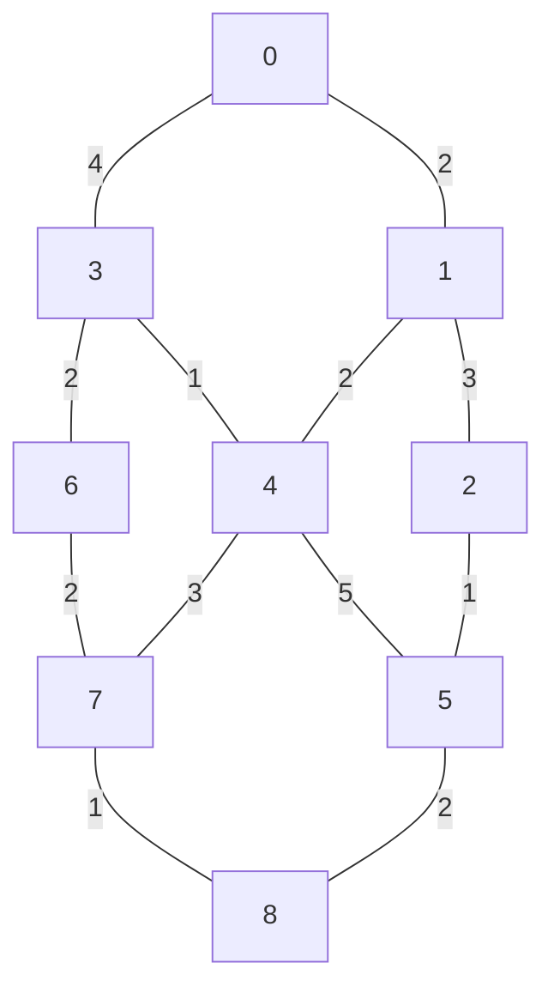
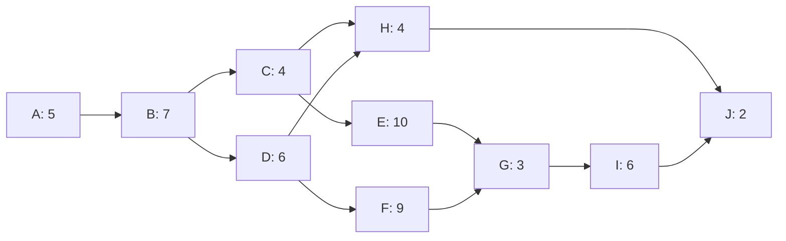

# Лабораторная работа № 10
## Алгоритмы поиска кратчайших путей и расчёта критического пути сетевого графика

**Выполнила:** Иванюшкина Дарья Андреевна  
**Группа:** БИ 2-3  
**Город:** Москва  
**Вариант:** 7  
**Дисциплина:** Теория алгоритмов

---

## 1. Цель работы

Изучить алгоритм Дейкстры в двух реализациях, восстановление кратчайшего пути, топологическую сортировку и метод критического пути. Сравнить время работы реализаций на решётчатых графах.

## 2. Задание варианта 7

- Тип графа: решётка `k × k`.
- Размеры решёток: `k = 30, 50, 70` (900, 2500 и 4900 вершин).
- Веса рёбер: целые числа от 1 до 100.
- Количество работ проекта: 10.
- Дополнительное задание К7: построить диаграмму Ганта с выделением критических работ.

Для решётки использованы связи между соседними по горизонтали и вертикали вершинами. Рёбра двусторонние, веса положительные и генерируются случайно с фиксированным начальным значением, чтобы результаты можно было повторить.

## 3. Используемые алгоритмы

### 3.1. Алгоритм Дейкстры с линейным поиском

На каждом шаге среди непосещённых вершин выбирается вершина с минимальным текущим расстоянием. Затем выполняется релаксация её исходящих рёбер. Сложность реализации — `Θ(n² + m)`, для решётки это `Θ(n²)`.

### 3.2. Алгоритм Дейкстры с приоритетной очередью

Для выбора вершины используется двоичная куча `heapq`. При изменении расстояния новая пара добавляется в очередь. Сложность — `O((n + m) log n)`, для связной решётки — `O(n log n)`.

Обе реализации возвращают расстояния и массив предков. По массиву предков восстанавливается сам кратчайший путь. Алгоритм Дейкстры применим, поскольку все веса рёбер неотрицательные.

### 3.3. Топологическая сортировка и критический путь

Топологическая сортировка выполнена алгоритмом Кана за `O(n + m)`. Прямой проход вычисляет ранние сроки `ES` и `EF`, обратный — поздние сроки `LS` и `LF`. Полный резерв равен `R = LS − ES`. Работы с нулевым резервом образуют критический путь.

## 4. Проверка кратчайшего пути вручную

Для проверки использован небольшой тестовый граф 3 × 3. Вершины пронумерованы от 0 до 8. Вес каждого ребра указан на схеме.



Ищем путь из вершины 0 в вершину 8. Например:

- `0 → 1 → 2 → 5 → 8`: `2 + 3 + 1 + 2 = 8`;
- `0 → 1 → 4 → 7 → 8`: `2 + 2 + 3 + 1 = 8`.

Минимальная длина пути равна **8**. Программа также находит расстояние 8 и восстанавливает один из кратчайших путей: `0 → 1 → 2 → 5 → 8`.

## 5. Сетевой график проекта

Для расчёта использован набор из 10 работ. Длительности и зависимости соответствуют таблице исходного задания.



## 6. Листинг программы

Полный код также приложен отдельным файлом `lr10_variant7.py`.

```python
import heapq
import random
import time
from collections import deque

INF = float("inf")


def dijkstra_array(graph, start):
    n = len(graph)
    dist = [INF] * n
    parent = [-1] * n
    used = [False] * n
    dist[start] = 0

    for _ in range(n):
        v = -1
        best = INF
        for i in range(n):
            if not used[i] and dist[i] < best:
                v, best = i, dist[i]
        if v == -1:
            break
        used[v] = True
        for u, w in graph[v]:
            if dist[v] + w < dist[u]:
                dist[u] = dist[v] + w
                parent[u] = v
    return dist, parent


def dijkstra_heap(graph, start):
    n = len(graph)
    dist = [INF] * n
    parent = [-1] * n
    dist[start] = 0
    heap = [(0, start)]

    while heap:
        d, v = heapq.heappop(heap)
        if d != dist[v]:
            continue
        for u, w in graph[v]:
            nd = d + w
            if nd < dist[u]:
                dist[u] = nd
                parent[u] = v
                heapq.heappush(heap, (nd, u))
    return dist, parent


def restore_path(parent, target):
    path = []
    while target != -1:
        path.append(target)
        target = parent[target]
    return path[::-1]


def make_grid(k, seed=42):
    rng = random.Random(seed)
    graph = [[] for _ in range(k * k)]

    def add_edge(a, b):
        w = rng.randint(1, 100)
        graph[a].append((b, w))
        graph[b].append((a, w))

    for r in range(k):
        for c in range(k):
            v = r * k + c
            if c + 1 < k:
                add_edge(v, v + 1)
            if r + 1 < k:
                add_edge(v, v + k)
    return graph


def topological_order(tasks):
    indeg = {v: len(data[1]) for v, data in tasks.items()}
    succ = {v: [] for v in tasks}
    for v, (_, preds) in tasks.items():
        for p in preds:
            if p not in tasks:
                raise ValueError("Неизвестная предшествующая работа: " + p)
            succ[p].append(v)

    q = deque(v for v in tasks if indeg[v] == 0)
    order = []
    while q:
        v = q.popleft()
        order.append(v)
        for u in succ[v]:
            indeg[u] -= 1
            if indeg[u] == 0:
                q.append(u)

    if len(order) != len(tasks):
        raise ValueError("В сетевом графике есть цикл")
    return order, succ


def critical_path(tasks):
    order, succ = topological_order(tasks)
    es, ef = {}, {}
    for v in order:
        duration, preds = tasks[v]
        es[v] = max((ef[p] for p in preds), default=0)
        ef[v] = es[v] + duration

    total = max(ef.values())
    ls, lf = {}, {}
    for v in reversed(order):
        duration = tasks[v][0]
        lf[v] = min((ls[u] for u in succ[v]), default=total)
        ls[v] = lf[v] - duration

    reserve = {v: ls[v] - es[v] for v in tasks}
    critical = [v for v in order if reserve[v] == 0]
    return total, es, ef, ls, lf, reserve, critical


def draw_gantt(tasks, es, ef, critical):
    try:
        import matplotlib.pyplot as plt
    except ImportError:
        print("Для диаграммы Ганта установите matplotlib: pip install matplotlib")
        return

    names = list(tasks)
    fig, ax = plt.subplots(figsize=(10, 5))
    for y, name in enumerate(names):
        start = es[name]
        duration = tasks[name][0]
        color = "tomato" if name in critical else "steelblue"
        ax.barh(y, duration, left=start, color=color, edgecolor="black")
        ax.text(start + duration / 2, y, name, ha="center", va="center")
    ax.set_yticks(range(len(names)), names)
    ax.set_xlabel("Дни")
    ax.set_title("Диаграмма Ганта (критические работы выделены)")
    ax.grid(axis="x", alpha=0.3)
    ax.invert_yaxis()
    fig.tight_layout()
    fig.savefig("gantt_variant7.png", dpi=150)
    plt.close(fig)
    print("Диаграмма сохранена: gantt_variant7.png")


if __name__ == "__main__":
    print("СРАВНЕНИЕ ДЕЙКСТРЫ ДЛЯ РЕШЁТОК")
    print(f"{'k':>5}{'n':>8}{'m':>10}{'массив, с':>14}{'куча, с':>12}")
    for k in (30, 50, 70):
        graph = make_grid(k, seed=42)
        n = k * k
        m = sum(map(len, graph)) // 2

        t0 = time.perf_counter()
        d1, _ = dijkstra_array(graph, 0)
        t_array = time.perf_counter() - t0

        t0 = time.perf_counter()
        d2, parent = dijkstra_heap(graph, 0)
        t_heap = time.perf_counter() - t0

        assert d1 == d2
        print(f"{k:>5}{n:>8}{m:>10}{t_array:>14.4f}{t_heap:>12.4f}")

    # Небольшой тестовый граф 3x3
    test = [
        [(1, 2), (3, 4)],
        [(0, 2), (2, 3), (4, 2)],
        [(1, 3), (5, 1)],
        [(0, 4), (4, 1), (6, 2)],
        [(1, 2), (3, 1), (5, 5), (7, 3)],
        [(2, 1), (4, 5), (8, 2)],
        [(3, 2), (7, 2)],
        [(4, 3), (6, 2), (8, 1)],
        [(5, 2), (7, 1)]
    ]
    dist, parent = dijkstra_heap(test, 0)
    print("\nТест 3x3: расстояние от 0 до 8 =", dist[8])
    print("Путь:", " -> ".join(map(str, restore_path(parent, 8))))

    tasks = {
        "A": (5, []), "B": (7, ["A"]), "C": (4, ["B"]),
        "D": (6, ["B"]), "E": (10, ["C"]), "F": (9, ["D"]),
        "G": (3, ["E", "F"]), "H": (4, ["C", "D"]),
        "I": (6, ["G"]), "J": (2, ["H", "I"])
    }
    total, es, ef, ls, lf, reserve, critical = critical_path(tasks)
    print("\nРАСЧЁТ КРИТИЧЕСКОГО ПУТИ")
    print(f"{'Работа':>8}{'t':>5}{'ES':>5}{'EF':>5}{'LS':>5}{'LF':>5}{'R':>5}")
    for v in tasks:
        print(f"{v:>8}{tasks[v][0]:>5}{es[v]:>5}{ef[v]:>5}{ls[v]:>5}{lf[v]:>5}{reserve[v]:>5}")
    print("Длительность проекта:", total, "дней")
    print("Критический путь:", " -> ".join(critical))
    draw_gantt(tasks, es, ef, critical)
```

## 7. Результаты измерений

Измерения выполнены при запуске программы на Python. Для каждого размера использовался один и тот же сгенерированный граф; результаты двух реализаций проверялись сравнением массивов расстояний.

| k | Число вершин n | Число рёбер m | Линейный поиск, с | Приоритетная очередь, с |
|---:|---:|---:|---:|---:|
| 30 | 900 | 1740 | 0.0348 | 0.0013 |
| 50 | 2500 | 4900 | 0.3017 | 0.0022 |
| 70 | 4900 | 9660 | 1.1581 | 0.0069 |

На всех трёх графах результаты двух реализаций совпали. При увеличении размера решётки реализация с кучей оказалась значительно быстрее. Это объясняется тем, что линейный поиск требует полного просмотра массива вершин на каждом шаге, а куча позволяет эффективнее выбирать вершину с минимальным расстоянием.

## 8. Расчёт сроков работ

| Работа | t, дни | ES | EF | LS | LF | Резерв R | Критическая |
|---|---:|---:|---:|---:|---:|---:|---|
| A | 5 | 0 | 5 | 0 | 5 | 0 | Да |
| B | 7 | 5 | 12 | 5 | 12 | 0 | Да |
| C | 4 | 12 | 16 | 13 | 17 | 1 | Нет |
| D | 6 | 12 | 18 | 12 | 18 | 0 | Да |
| E | 10 | 16 | 26 | 17 | 27 | 1 | Нет |
| F | 9 | 18 | 27 | 18 | 27 | 0 | Да |
| G | 3 | 27 | 30 | 27 | 30 | 0 | Да |
| H | 4 | 18 | 22 | 32 | 36 | 14 | Нет |
| I | 6 | 30 | 36 | 30 | 36 | 0 | Да |
| J | 2 | 36 | 38 | 36 | 38 | 0 | Да |

**Длительность проекта: 38 дней.**  
**Критический путь: A → B → D → F → G → I → J.**

## 9. Диаграмма Ганта (дополнительное задание К7)

Критические работы выделены красным цветом, остальные — синим.


## 10. Выводы

1. Реализованы две версии алгоритма Дейкстры: с линейным поиском минимума и с приоритетной очередью.
2. Обе реализации дали одинаковые результаты на решётках размером 30 × 30, 50 × 50 и 70 × 70.
3. На проверенных графах приоритетная очередь работала быстрее линейного поиска. С ростом размера графа разница увеличилась.
4. Для тестового графа 3 × 3 найден кратчайший путь длиной 8.
5. Для проекта из 10 работ рассчитана длительность 38 дней. Критический путь: `A → B → D → F → G → I → J`.
6. Выполнено дополнительное задание К7 — построена диаграмма Ганта с выделением критических работ.
